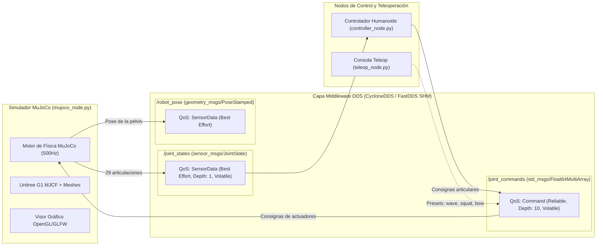

# Robot Humanoide Unitree G1 en MuJoCo con ROS 2 y DDS (UADE)

Este proyecto implementa la simulación y control en tiempo real del robot humanoide **Unitree G1** (utilizado en investigación y docencia en **UADE**) en el simulador de física **MuJoCo**, integrado con **ROS 2** y configurado con políticas de Calidad de Servicio (**QoS**) en la capa middleware **DDS (Data Distribution Service)**.

---

## 🤖 Especificaciones del Unitree G1

- **Grados de Libertad (DoF)**: 29 actuadores independientes + 6 DoF de base flotante (Pelvis).
  - **Pierna Izquierda (6 DoF)**: Cadera (pitch, roll, yaw), rodilla, tobillo (pitch, roll).
  - **Pierna Derecha (6 DoF)**: Cadera (pitch, roll, yaw), rodilla, tobillo (pitch, roll).
  - **Cintura / Torso (3 DoF)**: Yaw, roll, pitch.
  - **Brazo Izquierdo (7 DoF)**: Hombro (pitch, roll, yaw), codo, muñeca (roll, pitch, yaw).
  - **Brazo Derecho (7 DoF)**: Hombro (pitch, roll, yaw), codo, muñeca (roll, pitch, yaw).
- **Modelo Físico**: MJCF oficial de Google DeepMind / Unitree Robotics con mallas visuales y de colisión 3D de alta definición (`models/unitree_g1/scene.xml`).

---

## 📐 Arquitectura de Comunicación DDS



---

## 🌐 Configuración de DDS (Data Distribution Service)

1. **Políticas de Calidad de Servicio (QoS)** ([`dds_config.py`](file:///d:/proyectAgy/mujoco/src/mujoco_ros2_sim/mujoco_ros2_sim/dds_config.py)):
   - **`/joint_states` y `/robot_pose`**: `BEST_EFFORT` con profundidad 1 (`KEEP_LAST`). Para streaming físico a 100 Hz, la mínima latencia es prioritaria y no se retransmiten paquetes obsoletos.
   - **`/joint_commands`**: `RELIABLE` con profundidad 10. Garantiza que las consignas de movimiento y balance no se pierdan.
2. **Archivos de Configuración de Transporte**:
   - [`config/cyclonedds.xml`](file:///d:/proyectAgy/mujoco/config/cyclonedds.xml): Optimiza buffers de socket UDP para alto flujo de datos articulares.
   - [`config/fastdds.xml`](file:///d:/proyectAgy/mujoco/config/fastdds.xml): Habilita **Memoria Compartida (*SHM*)** para comunicación *Zero-Copy* en la misma máquina.

---

## 🚀 Cómo Ejecutar

### Opción 1: Probar inmediatamente en Windows (MuJoCo Nativo)

Puedes ver al robot humanoide **Unitree G1** de inmediato en tu máquina ejecutando:

```powershell
python run_standalone.py
```

* **Comportamiento**: El robot se inicializa en su postura de pie estable (`stand`) y ejecuta un movimiento de saludo con el brazo derecho mientras mantiene el equilibrio dinámico.
* **Interacción 3D**:
  - Clic izquierdo + arrastrar: Rotar la cámara.
  - Clic derecho + arrastrar: Mover la cámara (pan).
  - Rueda del ratón: Zoom.
  - **Doble clic en cualquier extremidad + arrastrar con clic derecho**: Aplicar fuerzas externas en tiempo real para probar la estabilidad física del humanoide.

---

### Opción 2: Ejecutar con ROS 2 en WSL2 (Ubuntu 24.04 / 22.04)

1. Entra a WSL:
   ```bash
   wsl -d Ubuntu
   cd /mnt/d/proyectAgy/mujoco
   ```
2. Ejecuta el script de instalación automática:
   ```bash
   chmod +x setup_wsl2.sh
   ./setup_wsl2.sh
   ```
3. Lanza la simulación completa y el nodo de control:
   ```bash
   source install/setup.bash
   export RMW_IMPLEMENTATION=rmw_cyclonedds_cpp
   export CYCLONEDDS_URI=file://$(pwd)/config/cyclonedds.xml
   export ROS_DOMAIN_ID=42

   # Lanza MuJoCo + Controlador en modo 'wave' (saludo)
   ros2 launch mujoco_ros2_sim full_demo.launch.py
   ```

   * Puedes cambiar el modo de movimiento con el argumento `mode`:
     ```bash
     ros2 launch mujoco_ros2_sim full_demo.launch.py mode:=squat  # Sentadilla
     ros2 launch mujoco_ros2_sim full_demo.launch.py mode:=bow    # Reverencia
     ros2 launch mujoco_ros2_sim full_demo.launch.py mode:=stand  # De pie fijo
     ```

---

### Opción 3: Teleoperación Interactiva

En otra terminal con el entorno cargado:

```bash
ros2 run mujoco_ros2_sim teleop_node
```

Permite aplicar presets o comandar articulaciones individuales:
- `wave` -> Saludo con brazo derecho.
- `squat` -> Sentadilla.
- `bow` -> Reverencia.
- `tpose` -> Postura en T.
- `stand` -> Regresar a postura de pie.
- `list` -> Listar los nombres y valores de los 29 actuadores.
- `set <indice> <radianes>` -> Modificar un ángulo articular individual.

---

### Opción 4: Docker

Si tienes Docker Desktop iniciado:
```powershell
docker compose up --build
```


🚀 Cómo Probarlo de Inmediato
1. Probar en Windows (MuJoCo Nativo)

Ejecuta en tu terminal PowerShell:

powershell
python run_standalone.py

Verás al Unitree G1 de pie ejecutando un saludo fluido con su brazo derecho. Puedes hacer doble clic en cualquier eslabón y arrastrar con clic derecho para perturbar físicamente al humanoide y ver cómo responde su dinámica.

2. Ejecutar con ROS 2 y DDS (WSL2 / Ubuntu)

En tu terminal de Ubuntu en WSL2:

bash
cd /mnt/d/proyectAgy/mujoco
./setup_wsl2.sh
source install/setup.bash
# Lanzar simulación completa y controlador en modo saludo
ros2 launch mujoco_ros2_sim full_demo.launch.py
# O en modo sentadilla:
ros2 launch mujoco_ros2_sim full_demo.launch.py mode:=squat

En otra terminal puedes abrir la consola de teleoperación:

bash
ros2 run mujoco_ros2_sim teleop_node